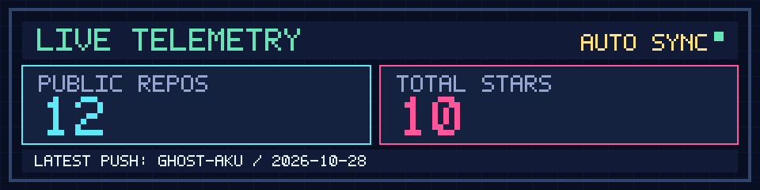
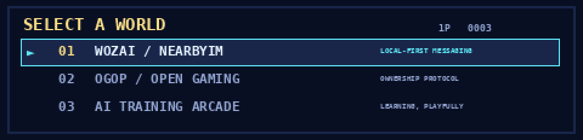
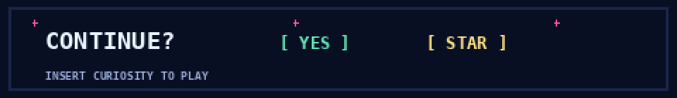

<!--
  GHOST-AKU // PIXEL PROFILE v1.0
  Original pixel artwork; no external image host or remote statistics cards.
  The GIFs loop locally. live-status.svg updates through GitHub Actions.
-->

<div align="center">
  
</div>

<p align="center">
  <code>⚡ PLAYER 01</code> &nbsp; <code>AI × CODE × WRITING</code> &nbsp; <code>✦ OPEN SOURCE</code>
</p>

<div align="center">
  <a href="https://github.com/GHOST-AKU/wozai">[ ENTER WOZAI ]</a> &nbsp;·&nbsp;
  <a href="https://github.com/GHOST-AKU/open-game-ownership-protocol">[ EXPLORE OGOP ]</a> &nbsp;·&nbsp;
  <a href="https://github.com/GHOST-AKU/ai-training-arcade">[ PLAY ARCADE ]</a>
</div>

<br />

### `> SYSTEM / LIVE TELEMETRY`

<p align="center">
  
</p>

<sub>GitHub 公共数据每六小时尝试更新一次（UTC）；图像可能因缓存或任务延迟而稍晚刷新。只统计公开仓库。</sub>

### `> QUEST BOARD / SELECT A WORLD`

<div align="center">
  
</div>

| WORLD | MISSION | TELEPORT |
|:--|:--|:--|
| `01` **WoZai / NearbyIM** | 原生、端到端加密、附近优先的即时通讯 | [进入仓库](https://github.com/GHOST-AKU/wozai) |
| `02` **OGOP** | 探索游戏数字所有权的开放协议 | [进入仓库](https://github.com/GHOST-AKU/open-game-ownership-protocol) |
| `03` **AI Training Arcade** | 将机器学习训练变成可视化的游乐场 | [进入仓库](https://github.com/GHOST-AKU/ai-training-arcade) |

### `> CHARACTER SHEET / PRESS A TO INSPECT`

<details>
<summary><b>🎮 OPEN INVENTORY / 展开角色资料</b></summary>

```text
╔══════════════════════════════════════════════╗
║  PLAYER      GHOST_AKU                      ║
║  CLASS       DEVELOPER × WRITER              ║
║  QUEST       CONNECT PEOPLE / OWN WORLDS     ║
║  SKILL 01    AI & SYSTEMS                    ║
║  SKILL 02    NATIVE APPLICATIONS             ║
║  SKILL 03    CREATIVE EXPERIMENTS            ║
║  ACHIEVEMENT STILL BUILDING ...              ║
╚══════════════════════════════════════════════╝
```

**你好！** 我喜欢创造开放、轻量、令人好奇的软件，也喜欢写作。这里记录一些正在发生的实验，而不是一份已经通关的履历。

**Hello!** I build things at the intersection of AI, native software, open protocols, and imagination. The game is never really over.

</details>

<br />

<div align="center">
  <a href="https://github.com/GHOST-AKU?tab=repositories">
    
  </a>
  <br />
  <sub>© GHOST-AKU — CURIOSITY IS THE FINAL BOSS.</sub>
</div>
