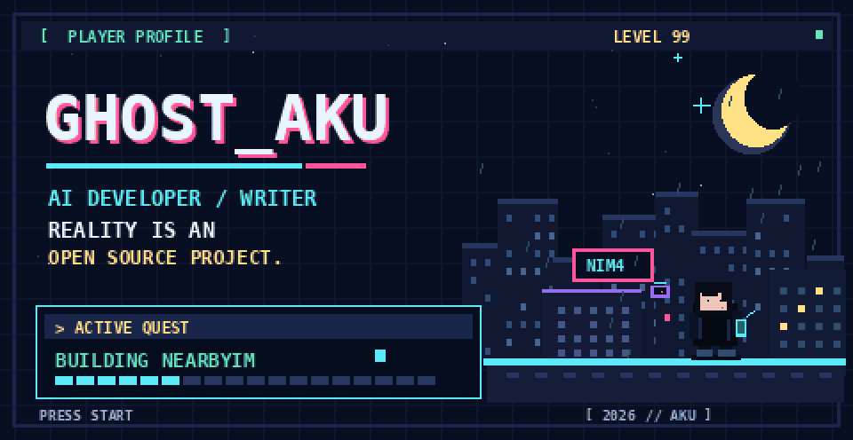

<p align="center">
  
</p>

<details>
<summary>More / 展开原有内容</summary>

# GHOST_AKU

**AI developer × writer** · 原生应用 / 开放协议 / 有趣的实验

> **REALITY IS AN OPEN-SOURCE PROJECT.**  
> 现实不是一款已经通关的游戏。它有缺陷、有分支，也永远值得下一个提交。

[**进入 WoZai**](https://github.com/GHOST-AKU/wozai) · [**游玩 AI Training Arcade**](https://ghost-aku.github.io/ai-training-arcade/) · [**查看所有仓库**](https://github.com/GHOST-AKU?tab=repositories)

```text
╭─ SAVE FILE / SLOT 01 ───────────────────╮
│ PLAYER   GHOST_AKU                       │
│ CLASS    DEVELOPER · WRITER              │
│ MODE     BUILD / EXPLORE / REPEAT        │
│ STATUS   STILL IN PROGRESS               │
╰──────────────────────────────────────────╯
```

我喜欢把抽象的问题做成能被使用、质疑、拆解和重新组合的东西：无需云端也能聊天的应用、讨论游戏所有权的开放协议，以及让人亲手参与训练过程的 AI 小实验。

*I build native software, explore open protocols, and turn machine-learning ideas into things people can play with.*

---

## 01 / ACTIVE QUESTS

### `01` 我在 · WoZai / NearbyIM

**附近的人，不必先经过远方。**

面向近距离通信的开源即时通讯应用：不需要注册账号，也不依赖云端聊天服务器。让设备在局域网或受支持的近距离链路上直接发现、信任并连接彼此。项目采用 NIM4 加密协议，持续打磨跨设备消息、文件传输和原生体验。

`LOCAL-FIRST` · `NATIVE CLIENTS` · `E2EE` · `NIM4`

**[查看源码与文档](https://github.com/GHOST-AKU/wozai)** · [获取发行版](https://github.com/GHOST-AKU/wozai/releases) · [跟进开发议题](https://github.com/GHOST-AKU/wozai/issues)

### `02` OGOP · Open Game Ownership Protocol

**买下游戏之后，究竟拥有了什么？**

OGOP 试着把游戏数字所有权和流转的规则写成开放、可讨论的协议，而不是让所有权只存在于某个平台的账户条款里。它仍在探索与演进中。

`DIGITAL OWNERSHIP` · `OPEN STANDARDS` · `WORK IN PROGRESS`

**[Open Gaming Oasis / 项目入口](https://opengamingoasis.com/)**

### `03` AI Training Arcade

**Don't just watch a model learn. Play the training loop.**

把机器学习从一张静态曲线变成可以玩的实验：调参数、观察结果、失败、重试，亲手理解模型如何做出决策。训练场涵盖决策树、梯度提升、聚类、神经网络等主题，更多内容仍在开发。

`MACHINE LEARNING` · `INTERACTIVE EXPERIMENTS` · `OPEN SOURCE`

**[▶ 立即游玩](https://ghost-aku.github.io/ai-training-arcade/)** · [查看源码](https://github.com/GHOST-AKU/ai-training-arcade)

---

## 02 / HOW I BUILD

| 原则 | 对我意味着什么 |
| --- | --- |
| **Native-first** | 尽可能尊重操作系统，认真对待性能、资源和交互体验。 |
| **Open by design** | 协议和实现应该能够被阅读、讨论和改进。 |
| **Local where possible** | 设备就在彼此身边时，没必要凡事都经过远方的服务器。 |
| **Play to understand** | 一个可以亲手试错的实验，往往比一张漂亮的概念图更有说服力。 |

这些不是完成勋章，而是我在项目中不断检验的选择。

---

## 03 / LIVE TELEMETRY

*直接写进 Markdown 的公开 GitHub 数据，不需要加载统计图片。计划每六小时检查一次；只有数据真正变化时才提交。*

<!-- AUTO_STATS:START -->
| PUBLIC REPOS | STARS RECEIVED | LATEST PUBLIC PUSH |
| :---: | :---: | :--- |
| **12** | **10** | [`wozai`](https://github.com/GHOST-AKU/wozai) · `2026-10-30` |
<!-- AUTO_STATS:END -->

<sub>仅统计公开仓库；最近一次推送排除本主页仓库，避免自动更新自己刷新自己。数据可能受 GitHub API 和定时任务延迟影响。</sub>

[查看活动与提交](https://github.com/GHOST-AKU?tab=overview) · [查看自动更新记录](https://github.com/GHOST-AKU/GHOST-AKU/actions/workflows/live-status.yml)

---

## 04 / BONUS STAGE

<details>
<summary><strong>▶ PLAY INTRO — 展开像素夜城动画</strong></summary>

<p align="center">
  
</p>

*这段像素动画是可选的开场画面，不是 README 的主要内容。*

</details>

<details>
<summary><strong>▶ OPEN INVENTORY — 其他实验与写作</strong></summary>

软件不只是功能列表，代码也不只是履历。我还关心叙事、研究方法、设计，以及那些暂时没有标准答案的问题。

[探索所有公开项目](https://github.com/GHOST-AKU?tab=repositories) · [联系我 / X](https://twitter.com/GHOST_AKU_AI)

</details>

---

<sub>**NO FINAL LEVEL. ONLY THE NEXT COMMIT.** · © GHOST-AKU</sub>


</details>
